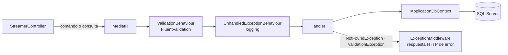
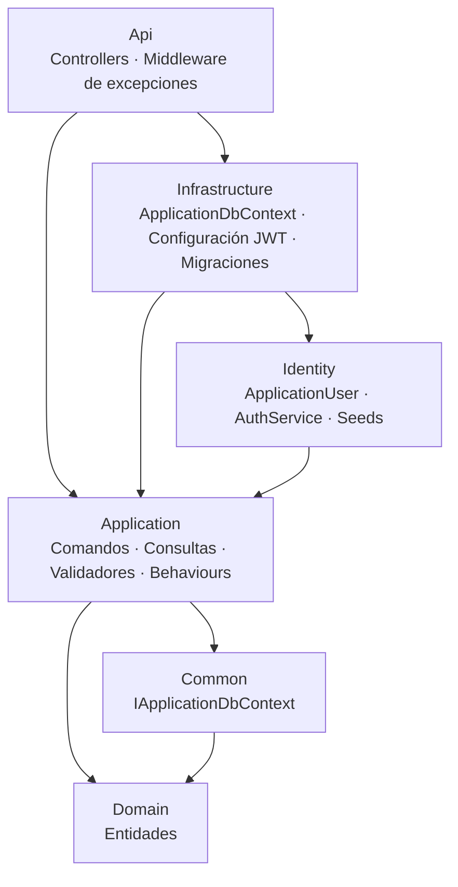

[English](README.md) · **Español**

# 🧩 Arquitectura base con CQRS


**Una plantilla liviana de ASP.NET Core con Clean Architecture, CQRS y JWT, pensada como base para APIs nuevas.**

---

## Sobre el proyecto

Una plantilla que uso como punto de partida para nuevas Web APIs. Mantiene las capas y convenciones de Clean Architecture, pero recorta la ceremonia: no hay repositorios ni Unit of Work. Los handlers hablan con EF Core a través de una interfaz chica, `IApplicationDbContext`, que ya cumple el rol de repositorio y de unit of work.

El dominio de ejemplo es una sola entidad, `Streamer`, con un CRUD completo: alcanza para mostrar todas las piezas funcionando juntas.

## Por qué sin repositorios

| Enfoque | Qué aporta | Qué cuesta |
| --- | --- | --- |
| Repositorios + Unit of Work | EF Core queda totalmente oculto detrás de interfaces propias | Un repositorio por entidad y una capa más para mantener alineada con el `DbContext` |
| **`IApplicationDbContext` (esta plantilla)** | Los handlers usan `DbSet<T>` y LINQ directamente; Application sigue dependiendo de una interfaz, no de Infrastructure | Application referencia las abstracciones de EF Core |

En la mayoría de las APIs centradas en CRUD, el `DbContext` ya es la abstracción que hace falta, así que la plantilla lo conserva y lo envuelve en una interfaz para facilitar los tests y la inversión de dependencias.

## Flujo de un request



## Highlights técnicos

- **CQRS con MediatR:** cada caso de uso es un comando o una consulta con su propio handler, en `Features/Streamers/Commands` y `Features/Streamers/Queries`.
- **Pipeline behaviours:** FluentValidation se ejecuta antes de cada handler, y las excepciones inesperadas se registran en un solo lugar.
- **Errores en un solo lugar:** `NotFoundException`, `BadRequestException` y `ValidationException` se convierten en respuestas HTTP consistentes mediante un único middleware.
- **Autenticación JWT con ASP.NET Core Identity:** roles `Administrator` y `Operator` más dos usuarios de prueba, cargados con configuraciones de EF Core.
- **AutoMapper** entre entidades y view models.

## Arquitectura



## Endpoints

| Endpoint | Acceso |
| --- | --- |
| `POST /api/v1/Account/Login` · `POST /api/v1/Account/Register` | Público |
| `GET /api/v1/Streamer` · `GET /api/v1/Streamer/{streamerName}` | Usuario autenticado |
| `POST /api/v1/Streamer` · `PUT /api/v1/Streamer` · `DELETE /api/v1/Streamer/{id}` | Usuario autenticado |

<details>
<summary><b>Estructura del proyecto</b></summary>

```text
ArquitecturaBase/
├── ArquitecturaBase.sln
├── Api/                 Controllers, middleware de errores, Program.cs
├── Application/
│   ├── Behaviours/      Behaviours de validación y de excepciones no controladas
│   ├── Contracts/       IAuthService
│   ├── Exceptions/
│   ├── Features/
│   │   └── Streamers/
│   │       ├── Commands/    Create, Update, Delete
│   │       └── Queries/     GetStreamerList, GetStreamerByName
│   ├── Mappings/        Perfil de AutoMapper
│   └── Models/Identity/ Requests, responses y configuración de JWT
├── Common/              IApplicationDbContext
├── Domain/              Streamer y tipos base
├── Identity/            ApplicationUser, AuthService, seeds de roles y usuarios
└── Infrastructure/      ApplicationDbContext, registro de servicios, migraciones
```

</details>

## Cómo ejecutar el proyecto

### Requisitos

- .NET 6 SDK
- SQL Server (sirve LocalDB o Express)
- CLI de EF Core: `dotnet tool install --global dotnet-ef`

### Ejecutar en local

```bash
git clone https://github.com/EmilianoBazanZapata/Arquitectura-Base-CQRS-.git
cd Arquitectura-Base-CQRS-/ArquitecturaBase
```

1. Configurar la cadena de conexión y una clave de firma JWT con user secrets. La cadena por defecto de `appsettings.json` usa autenticación de Windows sobre `localhost`.

   ```bash
   cd Api
   dotnet user-secrets init
   dotnet user-secrets set "JwtSettings:Key" "<una clave larga y aleatoria>"
   dotnet user-secrets set "ConnectionStrings:ConnectionString" "<tu cadena de conexión de SQL Server>"
   cd ..
   ```

2. Crear la base a partir de la migración incluida. También carga los roles y los usuarios de prueba definidos en `Identity/Configurations/UserConfiguration.cs`.

   ```bash
   dotnet ef database update --project Infrastructure --startup-project Api
   ```

3. Ejecutar con `dotnet run --project Api` y abrir Swagger en `https://localhost:7216/swagger`.

### Probarlo

Iniciar sesión con `POST /api/v1/Account/Login` usando uno de los usuarios de prueba o uno creado con `Register`, y enviar el token como `Authorization: Bearer <token>` a los endpoints de Streamer.

## Créditos

Hecho por Emiliano Bazán-Zapata.

---

**Binary Suns Studio** · [Web](https://binarysunsstudio.com.ar) · [GitHub](https://github.com/EmilianoBazanZapata) · [LinkedIn](https://www.linkedin.com/in/emiliano-bazán-zapata-18705721a)
