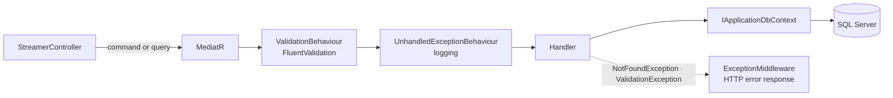
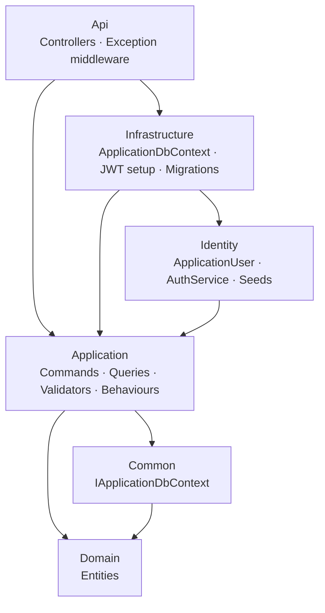

**English** · [Español](README.es.md)

# 🧩 Base Architecture with CQRS


**A lean ASP.NET Core starter with Clean Architecture, CQRS and JWT, meant as the base for new APIs.**

---

## About the project

A template I use as a starting point for new Web APIs. It keeps the layers and conventions of Clean Architecture, but cuts the ceremony: there are no repositories or Unit of Work. Handlers talk to EF Core through a small `IApplicationDbContext` interface, which already behaves as a repository and a unit of work.

The sample domain is a single `Streamer` entity with a full CRUD, enough to show every piece working together.

## Why no repositories

| Approach | What you get | What it costs |
| --- | --- | --- |
| Repositories + Unit of Work | EF Core fully hidden behind your own interfaces | One repository per entity, and an extra layer to keep in sync with `DbContext` |
| **`IApplicationDbContext` (this template)** | Handlers use `DbSet<T>` and LINQ directly; Application still depends on an interface, not on Infrastructure | Application references EF Core abstractions |

For most CRUD-heavy APIs, `DbContext` is already the abstraction you need, so this template keeps it and wraps it in an interface for testing and inversion of control.

## Request flow



## Technical highlights

- **CQRS with MediatR:** each use case is a command or a query with its own handler, under `Features/Streamers/Commands` and `Features/Streamers/Queries`.
- **Pipeline behaviours:** FluentValidation runs before every handler, and unexpected exceptions are logged in one place.
- **Errors in one place:** `NotFoundException`, `BadRequestException` and `ValidationException` are turned into consistent HTTP responses by a single middleware.
- **JWT authentication with ASP.NET Core Identity:** `Administrator` and `Operator` roles plus two demo users, seeded through EF Core configurations.
- **AutoMapper** between entities and view models.

## Architecture



## Endpoints

| Endpoint | Access |
| --- | --- |
| `POST /api/v1/Account/Login` · `POST /api/v1/Account/Register` | Public |
| `GET /api/v1/Streamer` · `GET /api/v1/Streamer/{streamerName}` | Authenticated user |
| `POST /api/v1/Streamer` · `PUT /api/v1/Streamer` · `DELETE /api/v1/Streamer/{id}` | Authenticated user |

<details>
<summary><b>Project structure</b></summary>

```text
ArquitecturaBase/
├── ArquitecturaBase.sln
├── Api/                 Controllers, error middleware, Program.cs
├── Application/
│   ├── Behaviours/      Validation and unhandled exception behaviours
│   ├── Contracts/       IAuthService
│   ├── Exceptions/
│   ├── Features/
│   │   └── Streamers/
│   │       ├── Commands/    Create, Update, Delete
│   │       └── Queries/     GetStreamerList, GetStreamerByName
│   ├── Mappings/        AutoMapper profile
│   └── Models/Identity/ Auth requests, responses and JWT settings
├── Common/              IApplicationDbContext
├── Domain/              Streamer and base types
├── Identity/            ApplicationUser, AuthService, role and user seeds
└── Infrastructure/      ApplicationDbContext, service registration, migrations
```

</details>

## Getting started

### Requirements

- .NET 6 SDK
- SQL Server (LocalDB or Express works)
- EF Core CLI: `dotnet tool install --global dotnet-ef`

### Run locally

```bash
git clone https://github.com/EmilianoBazanZapata/Arquitectura-Base-CQRS-.git
cd Arquitectura-Base-CQRS-/ArquitecturaBase
```

1. Set the connection string and a JWT signing key with user secrets. The default connection string in `appsettings.json` uses Windows authentication on `localhost`.

   ```bash
   cd Api
   dotnet user-secrets init
   dotnet user-secrets set "JwtSettings:Key" "<a long random key>"
   dotnet user-secrets set "ConnectionStrings:ConnectionString" "<your SQL Server connection string>"
   cd ..
   ```

2. Create the database from the committed migration. It also seeds the roles and the demo users defined in `Identity/Configurations/UserConfiguration.cs`.

   ```bash
   dotnet ef database update --project Infrastructure --startup-project Api
   ```

3. Run it with `dotnet run --project Api` and open Swagger at `https://localhost:7216/swagger`.

### Try it

Log in with `POST /api/v1/Account/Login` using a seeded user or one created with `Register`, then send the token as `Authorization: Bearer <token>` to the Streamer endpoints.

## Credits

Built by Emiliano Bazán-Zapata.

---

**Binary Suns Studio** · [Website](https://binarysunsstudio.com.ar) · [GitHub](https://github.com/EmilianoBazanZapata) · [LinkedIn](https://www.linkedin.com/in/emiliano-bazán-zapata-18705721a)
